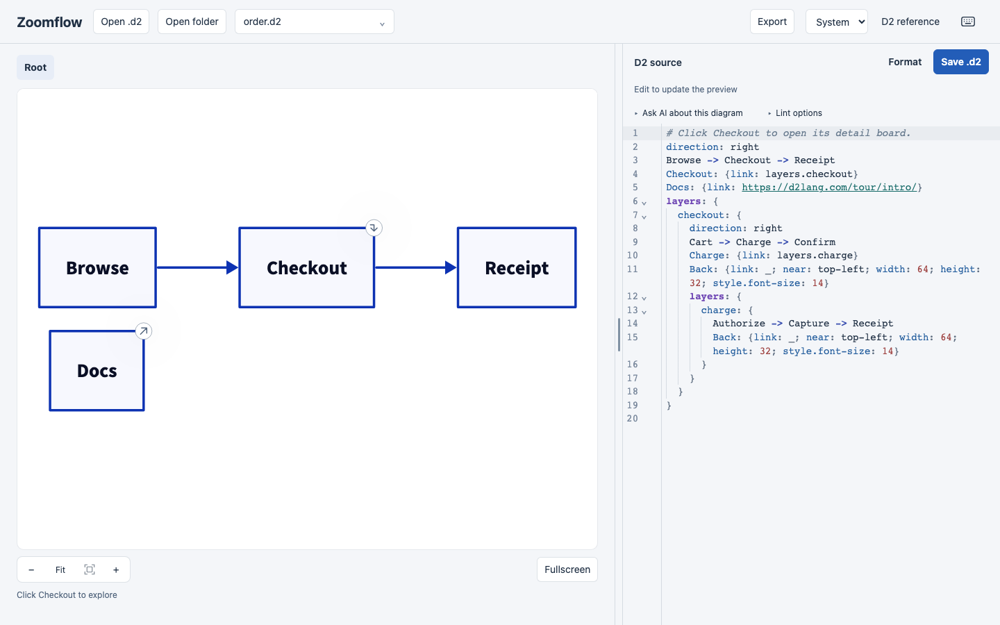

# Zoomflow

[](https://github.com/sglavoie/zoomflow/actions/workflows/pages.yml)
[](LICENSE)

Build flows with a form or edit D2 source, explore drill-down diagrams, and export a navigable HTML file that
works offline. Diagrams compile locally in your browser.

**[Try it in your browser](https://sglavoie.github.io/zoomflow/)**: no install needed.
Ask AI needs a local server, so it is available only when you [run locally](#run-locally).

**Status:** early development; expect breaking changes. The CLI runs from source and
is not published to npm.



## Run locally

Use Node 26 (verified with 26.10.0) and pnpm 12.6.0:

```sh
pnpm install
pnpm dev
```

Open the local URL printed by Vite. The app starts with an editable order-flow example.
The diagram engine loads on first use; you can edit while it loads. If startup fails,
use **Retry preview** to try again without losing your source.

## Edit → explore → export

1. **Create:** choose **New flow** to name steps and connect them without writing
   diagram syntax. Start with a simple flow or an approval with Yes/No branches.
   Use **Edit flow** above the preview to keep editing in the form. **New mind map**
   turns an indented outline into a mind map whose deep branches open as their own
   boards; **Edit mind map** reopens the outline. Or change the
   D2 source on the right and watch the preview update. Use the
   filename menu for built-in examples, **Open .d2** for a file, or **Open folder** for
   a project with relative imports. **D2 reference** contains searchable examples.
2. **Explore:** click **Checkout** in the default diagram, then **Charge** to drill
   deeper. Use breadcrumbs to return, or zoom and drag to inspect the diagram.
   Click an ordinary shape to select its source. On narrow screens, switch between
   **Preview** and **Source**.
3. **Keep and share:** use **Save .d2** (⌘S / Ctrl+S) for source. In **Export**, choose
   **Interactive diagram (HTML)** for one file with offline drill-down navigation,
   **Current board image** as SVG or PNG, or **All boards as SVG (ZIP)**.

Edits have browser recovery backups, but save a disk copy to keep them. Browsers
without direct file access offer **Download .d2**. Syntax errors retain the last
good preview; **Go to error** and **Diagnostics** lead back to the relevant source.

## Guides

- [Workspace guide](docs/workspace.md): projects, saving and recovery, navigation,
  source editing, diagnostics, keyboard controls, reference, side-by-side diagrams,
  and exports.
- [Ask AI](docs/ai.md): local Claude Code / Codex setup, configuration, cancellation,
  and undo.
- [Command line and CI](docs/cli.md): linting, headless exports, exit codes, and workflows.
- [Development](docs/development.md): checks, package boundaries, compiler contracts,
  and known limitations.
- [Browser tests](tests/e2e/README.md): behavioral coverage and visual baseline review.

## Check a change

```sh
pnpm typecheck
pnpm lint
pnpm test:unit
pnpm test:e2e
pnpm build
```

Install test browsers with `pnpm exec playwright install`. CLI export tests also
require native D2 v0.9.0; see the [CLI setup](docs/cli.md). Production output is in
`apps/web/dist`;
every push to `main` deploys it to GitHub Pages once typecheck, lint, unit tests and the
production smoke tests pass.

## Contributing and security

Issues and pull requests are welcome; run the checks above before opening one.
Report vulnerabilities privately as described in [SECURITY.md](SECURITY.md).

## License

Zoomflow is released under the [MIT License](LICENSE). It bundles a patched build of
[D2](https://github.com/d2lang/d2) under the Mozilla Public License 2.0
([details](vendor/d2/README.md)) and Source Sans Pro under the SIL Open Font
License 1.1 ([details](fonts/README.md)).
