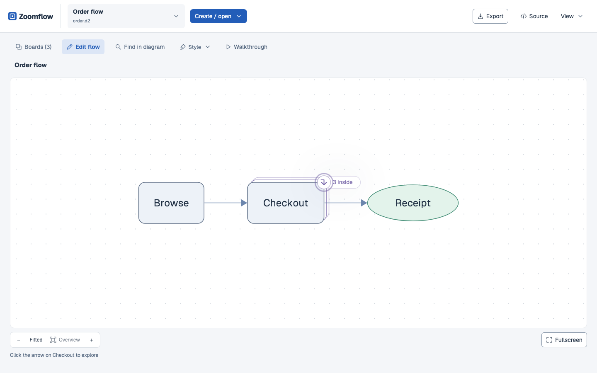

# Zoomflow

[](https://github.com/sglavoie/zoomflow/actions/workflows/pages.yml)
[](LICENSE)

Build flows with a form or edit D2 source, explore drill-down diagrams, and export a navigable HTML file that
works offline. Link a folder of diagrams into one atlas, from a home board down to one process.
Diagrams compile locally in your browser.

**[Try it in your browser](https://sglavoie.github.io/zoomflow/)**: no install needed.
Ask AI needs a local server, so it is available only when you [run locally](#run-locally).

**Status:** early development; expect breaking changes. Download builds from
[GitHub Releases](https://github.com/sglavoie/zoomflow/releases), or run from source.
The project is not published to npm.



## Run locally

Use Node 26 (verified with 26.10.0) and pnpm 12.6.0:

```sh
pnpm install
pnpm dev
```

Open the local URL printed by Vite. The app starts with an editable order-flow example.
The diagram engine loads on first use; you can edit while it loads. If startup fails,
use **Retry preview** to try again without losing your source.

On first load, the starter arrives in reading order, then the Checkout arrow pulses
until you explore a detail board or dismiss the coach. Tips wait for that first
drill or about four seconds without input, and remember your progress. Pristine
built-in examples also arrive when chosen from the filename menu; edits and
recovered drafts stay still. Reduced motion skips arrival and uses a static arrow
highlight. Exported HTML arrives once when opened, including offline.

## Edit → explore → export

1. **Create:** choose **Create / open → New flow** to type one step per line and connect them automatically. Start with a single step,
   or switch to **Full builder** for decisions and Yes/No branches.
   Use **Edit flow** above the preview to keep editing in the form. **New mind map**
   turns an indented outline into a mind map whose deep branches open as their own
   boards; **Edit mind map** reopens the outline. Select or right-click any shape to
   give it a flow or mind map board of its own, so flows and mind maps can open from
   each other. On those boards, rename, add and remove steps and topics right on the
   diagram with F2, ⌘/Ctrl+Enter, Enter and Delete. **More** and right-click open the
   grouped shape menu, with shortcut hints and **Delete** at the end. On flow boards, **Connect to…**
   adds an arrow to another step; select an arrow to edit its label or delete it.
   Drag a node onto a new parent, or use **Move branch…** to choose from a list.
   The dragged node lifts and valid parents glow; added steps scale in and deleted
   steps briefly collapse. Reduced motion keeps only the static drop highlight.
   Mind maps move the whole topic branch; flows and custom D2 diagrams change the
   node's incoming connections and keep its downstream branch attached.
   Move flow or mind-map branches onto parents on other boards too; each branch
   keeps its own editor, including when moving between flows and mind maps.
   Or open **Source** to change the D2 source and watch
   the preview update. Use the
   filename menu for built-in examples with the same filled style and small board pictures, **Open .d2** for a
   file, or **Open folder** for a project with relative imports. In a folder,
   **Link to diagram…** and **New linked
   diagram…** on a shape's menu make it open another file of the project
   ([atlas guide](docs/workspace.md#link-diagrams-into-an-atlas)); **New atlas in an empty
   folder** in the filename menu starts one from nothing. **D2 reference**
   contains searchable examples.
2. **Explore:** use the arrow on **Checkout** in the default diagram, then **Charge** to drill
   deeper. The linked shape’s frame grows into the next board and shrinks back on return,
   with staggered fades that keep labels clear, including in offline HTML exports.
   On any starter board, double-click a step to rename it, or select it
   and choose **Add next step** or **Add branch** to keep building. Hover a connection
   and click **+** to insert a step between its ends. **Walkthrough** lets you follow
   a path, choose branches, and explore detail boards. Choose **Present** for a focused
   canvas that smoothly centres the current step alongside its outgoing steps, with readable
   muted paths and a name-first card. A brief bright pulse follows each advanced edge,
   including in offline HTML; hovered or selected editor edges flow slowly. Reduced
   motion keeps both still, and SVG/PNG downloads keep their static appearance. Use breadcrumbs or **Boards** to move around, hover a link or its badge to preview its
   board, or zoom and drag to inspect the diagram. Board names follow their linking
   shape labels when those labels agree, with the document title at the root. **Overview** fits the whole diagram at a
   comfortable scale, up to 1.5×; phones start closer only when fitted labels fall below 11 px.
   **Command palette** in View (⌘K on Mac / Ctrl+K elsewhere) finds commands,
   boards by display name, and built-in examples from the canvas or source editor.
   Type to filter, use ↑/↓ and Enter to run, or Escape to return to your work.
   Commands follow the last focused pane and list only available actions.
   A small minimap appears when part of a board is outside the view; click or drag it to pan.
   It also works offline and stays out of downloaded images.
   A quiet dot grid follows pan and zoom, including in offline HTML, and stays out of SVG and PNG images.
   Dark mode uses warmer surfaces and softly lit filled nodes in the workspace and offline HTML; SVG and PNG downloads keep their flat image palette. **Find in diagram** (⌘⇧F / Ctrl+Shift+F)
   finds board names and shape labels across the current document and jumps to a match.
   In an open folder, **Find in project** searches every project file, including unsaved
   edits and unlinked diagrams; ⌘⇧F / Ctrl+Shift+F opens project search there.
   **Check project** checks every file for compilation errors and lint issues, including
   links to missing files or boards; choose an issue to open its source.
   In a folder, links to other files
   open them with breadcrumbs that lead back, and **Atlas map** under the project in the
   filename menu draws every file and the links between them.
   Click an ordinary shape to select its source. On narrow screens, switch between
   **Preview** and **Source**.
   To curate an export, right-click a node and choose **Hide from export**, or focus it
   and press **H** to toggle. Hidden nodes stay dimmed and labeled in the editor;
   exports omit them, their connected children, linked detail layers, and connections.
   Downloads fit the visible content and close gaps left by hidden layers.
   Choices and layer settings are backed up per document in this browser and survive
   reloads. **Reset export visibility** in Export includes every shape again.
3. **Keep and share:** use **Save .d2** (⌘S / Ctrl+S) for source. In an open folder,
   **Save all** beside the project's unsaved count saves changed files together.
   **Export → Download Zoomflow project** keeps editable D2 files and view settings
   together in a `.zoomflow.zip` archive. Use **Open Zoomflow project** in the
   filename menu, or drop the archive, to open a separate project copy on any computer.
   This backup includes hidden content; diagram exports below omit it.
   **Export → Copy share link** puts a single-file diagram and its current board in
   a URL. Anyone with the link can read all its source, including hidden content.
   Opening it creates a new unsaved **Shared diagram**, preserving existing drafts.
   Links are limited to 8,000 characters; use interactive HTML for larger diagrams
   and atlas HTML for folder projects.
   In **Export**, choose
   **Interactive diagram (HTML)** for one file with offline drill-down navigation,
   **Interactive atlas (HTML)** for a project file and every file it links to,
   **Current board image** as SVG or PNG, or **All boards as SVG or PNG (ZIP)**.
   With **Current board image (PNG)** selected, **Copy PNG** puts the image on your
   clipboard for pasting into another app.
   Interactive HTML includes offline search for boards and shapes, across every
   bundled file in an atlas. **Export → Presentation** adds a display title and subtitle,
   chooses the opening board and mode for HTML, or frames SVG/PNG images for sharing.

Edits have browser recovery backups, but save a disk copy or download a Zoomflow project to keep them. Browsers
without direct file access offer **Download .d2**. Syntax errors retain the last
good preview; **Go to error** and **Diagnostics** lead back to the relevant source.

## Guides

- [Workspace guide](docs/workspace.md): projects, atlases of linked files, saving and
  recovery, navigation, source editing, diagnostics, keyboard controls, reference,
  side-by-side diagrams, and exports.
- [Standard library](stdlib/README.md): classes for flows, mind maps and common roles,
  and a project style sheet that restyles every diagram that uses them.
- [Ask AI](docs/ai.md): local Claude Code / Codex setup, configuration, cancellation,
  and undo.
- [Command line and CI](docs/cli.md): linting, headless exports, exit codes, and workflows.
- [Development](docs/development.md): checks, package boundaries, compiler contracts,
  and known limitations.
- [Releases](docs/releases.md): version bumps, GitHub Releases, downloadable builds,
  and retries.
- [Browser tests](tests/e2e/README.md): behavioral coverage and visual baseline review.

## Check a change

```sh
pnpm typecheck
pnpm lint
pnpm test:unit
pnpm test:e2e
pnpm build
pnpm test:e2e:production
```

Install test browsers with `pnpm exec playwright install`. CLI export tests also
require native D2 v0.9.0; see the [CLI setup](docs/cli.md). Production output is in
`apps/web/dist`. The last command runs two production smoke tests, not a second
full browser suite. To run the full matrix against the built app instead, use
`pnpm build && pnpm test:e2e:built` in place of the two browser commands above;
CI uses that production mode. For iteration, pass the affected spec to
`pnpm test:e2e tests/e2e/diagram-search.spec.ts`.

Every push to `main` deploys it to GitHub Pages once typecheck, lint, unit tests and the
production smoke tests pass.

## Contributing and security

Issues and pull requests are welcome; run the checks above before opening one.
Report vulnerabilities privately as described in [SECURITY.md](SECURITY.md).

## License

Zoomflow is released under the [MIT License](LICENSE). It bundles a patched build of
[D2](https://github.com/d2lang/d2) under the Mozilla Public License 2.0
([details](vendor/d2/README.md)) and Geist and Geist Mono under the SIL Open Font
License 1.1 ([details](fonts/README.md)).
